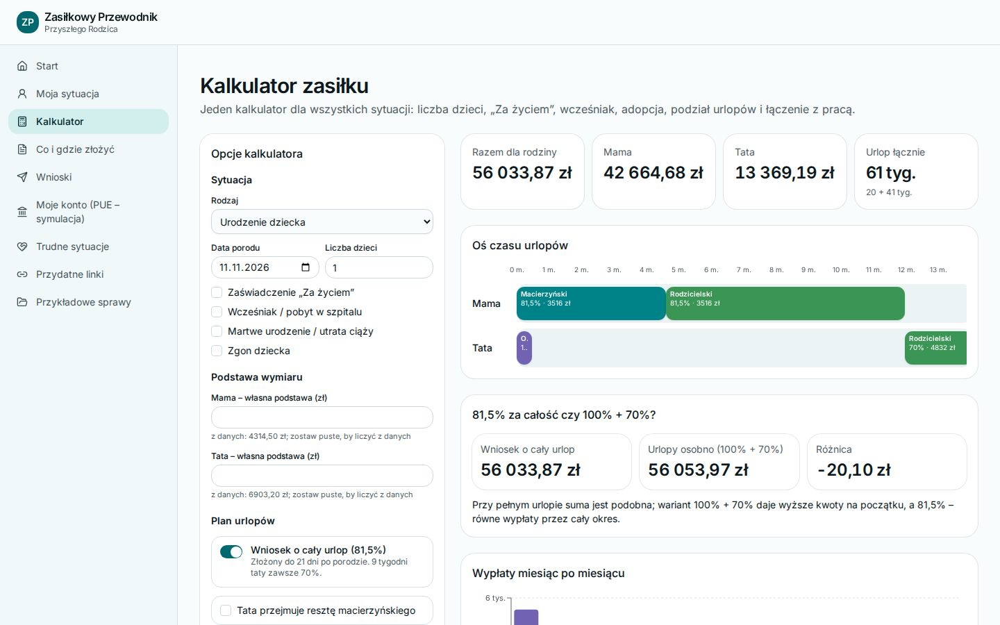

# Zasiłkowy Przewodnik Przyszłego Rodzica

**Jedno miejsce, w którym przyszły rodzic sprawdza swoje prawo do zasiłków, widzi ich wysokość na osi czasu i dostaje gotowe wnioski – z wyjaśnieniem każdego wyliczenia i podstawą prawną.**

Aplikacja webowa (RWD) na HackNation 2026, zadanie ZUS. Indywidualnie ustala uprawnienia i wylicza zasiłek chorobowy w ciąży oraz zasiłek macierzyński we wszystkich wariantach (oboje rodzice, łączenie z pracą, wieloraczki, „Za życiem”, wcześniak, adopcja, piecza) w jednym zintegrowanym kalkulatorze. Prowadzi przez dokumenty i wnioski, ostrzega przed utratą uprawnień, pomaga w trudnych sytuacjach i symuluje integracje (mObywatel, dane ZUS, PUE/eZUS, e-ZLA). Przepisy są parametrami edytowanymi w panelu administracyjnym.

| | |
|---|---|
| 📄 Szczegółowy opis projektu | [docs/opis-projektu.md](docs/opis-projektu.md) – pokrycie wymagań ZUS, architektura, AI, rozwiązania zewnętrzne, zrzuty |
| 🌐 Demo | _uzupełnić po wdrożeniu na Vercel_ – hasło panelu admina: `demo-zus` |
| 🎬 Film (≤ 3 min) | _wkrótce_ – po publikacji także na stronie `/o-projekcie`; skrypt: [docs/film-skrypt.md](docs/film-skrypt.md) |
| 📊 Prezentacja | [docs/prezentacja.html](docs/prezentacja.html) (10 slajdów), notatki: [docs/pitch-notatki.md](docs/pitch-notatki.md) |
| 🔌 REST API | [docs/api.md](docs/api.md) |
| 🤖 AI | wyliczenia są regułowe; AI (Claude) tylko **odczytuje wgrane PDF** do formularza, który użytkownik zatwierdza (`/sprawy`, wymaga `ANTHROPIC_API_KEY`); szczegóły w opisie, rozdz. 6 |



**Szybki test:** `/demo/anna` (umowa o pracę, ciąża), `/demo/kasia` (działalność, po porodzie), `/demo/ola` (brak prawa do zasiłku), `/sprawy` (wybór lub upload przykładowej sprawy z porównaniem do wyniku ZUS), `/kalkulator`, `/admin`.

Stos: Next.js 16 (UI + REST API), TypeScript, Tailwind CSS 4, shadcn/ui, zod, vitest, Playwright.

## Uruchomienie

```bash
npm i
npm run dev      # http://localhost:3000
npm test         # testy (vitest)
npm run typecheck
npm run build
npm run cases      # runner przykładowych spraw (fixtures + cases-private)
npm run e2e        # testy E2E Playwright (build + start na porcie 3100, desktop 1440×900 i iPhone 13)
npm run screens    # zrzuty ekranu do docs/screens
```

Przed pierwszym `npm run e2e` pobierz przeglądarkę: `npx playwright install chromium`. Raport: `npx playwright show-report`.
Ręczne testy przed demo: [docs/checklista-reczna.md](docs/checklista-reczna.md).

## Struktura

- `src/engine/` — czysta logika zasiłków (bez React/Next)
- `src/forms/` — definicje wniosków (urlopy, ZAM, odpis aktu urodzenia)
- `src/data/` — organizacje charytatywne i przydatne linki (ze źródłem i datą weryfikacji)
- `e2e/` — testy E2E (Playwright); `scripts/screens/` — zrzuty ekranu
- `src/config/params.default.json` — domyślne parametry
- `src/server/` — magazyn parametrów i mocki integracji
- `src/app/api/` — REST API
- `src/components/` — komponenty UI (shadcn/ui w `ui/`)
- `src/fixtures/cases/` — syntetyczne przykładowe sprawy
- `docs/` — dokumentacja

> Oryginalne zestawy spraw od ZUS nie mogą być kopiowane ani publikowane — trzymaj je lokalnie w `cases-private/` (ignorowane przez git).

## Parametry zasiłków i panel admina

Stawki i wymiary są w `src/config/params.default.json`, nie w kodzie. W runtime udostępnia je `ParamsStore`:

- lokalnie: plik `data/params.json` (gitignore),
- na Vercelu: Upstash Redis, jeśli ustawisz `UPSTASH_REDIS_REST_URL` i `UPSTASH_REDIS_REST_TOKEN`; bez tego pamięć, a zmiany giną przy restarcie.

| Metoda | Ścieżka | Opis |
|--------|---------|------|
| GET | `/api/params` | aktualne parametry |
| PUT | `/api/params` | zapis (nagłówek `x-admin-key` albo sesja panelu; opcjonalnie `x-admin-author`, `x-change-note`) |
| POST | `/api/params/reset` | przywrócenie domyślnych (admin) |
| GET | `/api/params/history` | historia zmian |

Panel administracyjny: **`/admin`** (logowanie hasłem → sesja w ciasteczku httpOnly). Bez ustawionej zmiennej `ADMIN_PASSWORD` działa hasło demonstracyjne **`demo-zus`** – w produkcji ustaw własne (skopiuj `.env.example` do `.env.local`).

## Przykładowe sprawy

Syntetyczne sprawy demo są w `src/fixtures/cases`, a prywatne sprawy ZUS tylko lokalnie w `cases-private/`. Opis: [docs/przyklady-zus.md](docs/przyklady-zus.md). REST API: [docs/api.md](docs/api.md).

## Deploy (Vercel)

1. Zaloguj się na [vercel.com](https://vercel.com) i wybierz **Add New → Project**.
2. Zaimportuj repozytorium `zasilkowy-przewodnik` z GitHuba.
3. W **Environment Variables** ustaw `ADMIN_PASSWORD` (opcjonalnie zmienne Upstash).
4. Framework zostanie wykryty automatycznie (Next.js) — kliknij **Deploy**.
